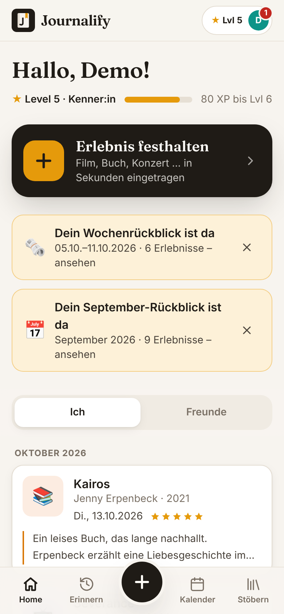
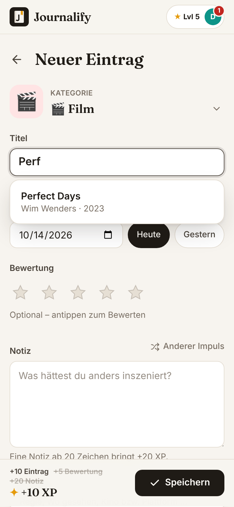
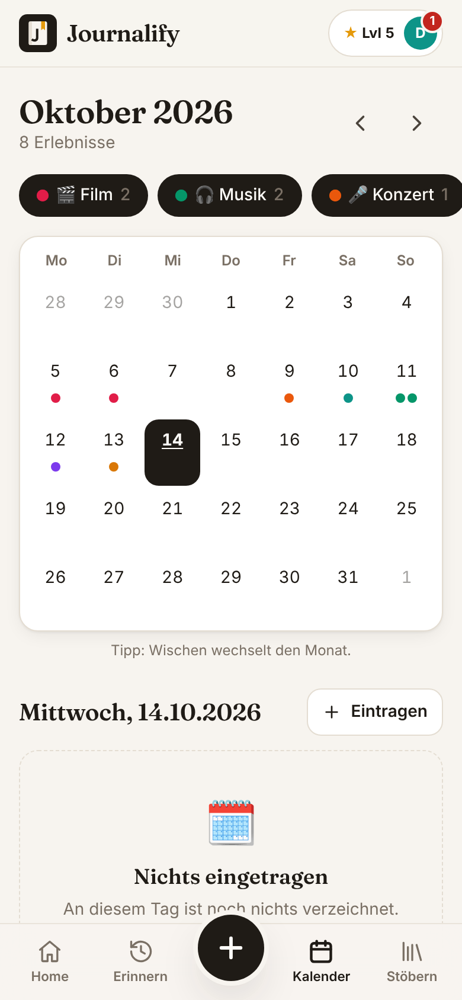
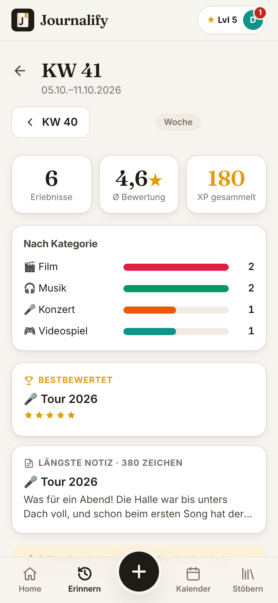
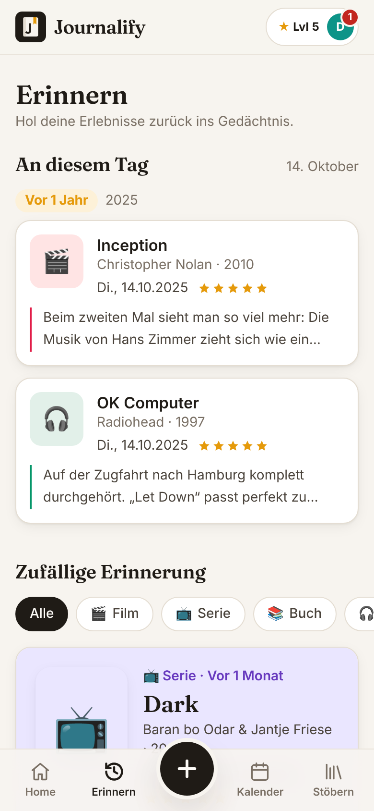
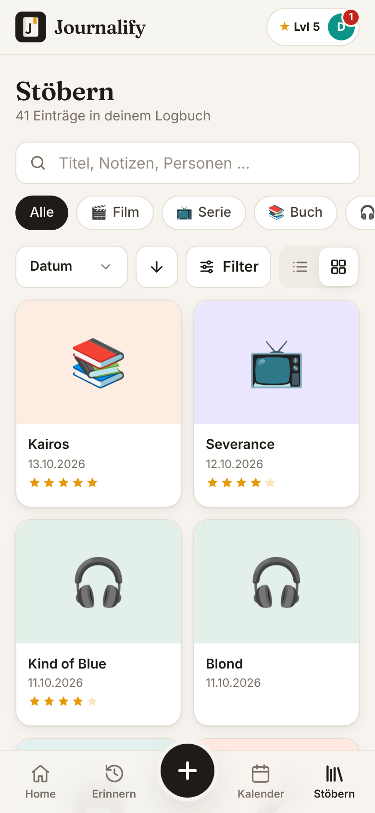
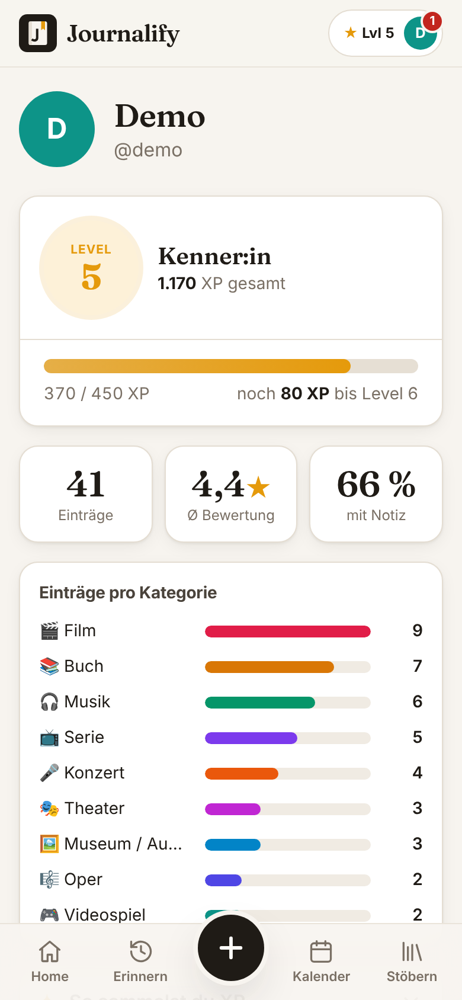
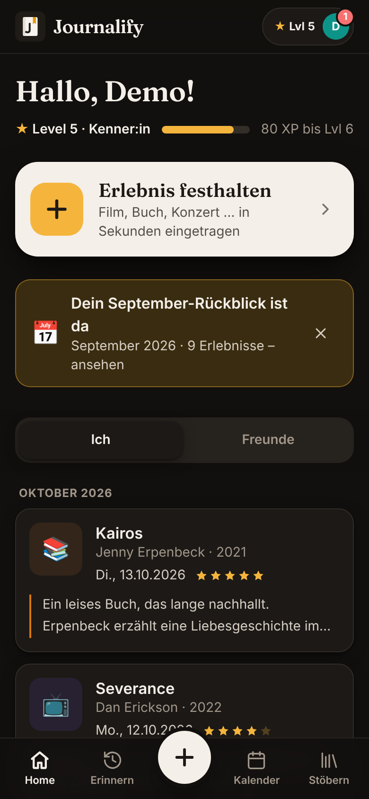

<div align="center">


# Journalify

**Dein persönliches Logbuch für Kultur-Erlebnisse.**

Filme, Serien, Bücher, Musik, Konzerte, Theater, Oper und Ausstellungen – mit Datum, Bewertung und
Notizen festgehalten, übersichtlich dargestellt und gezielt wieder in Erinnerung gerufen.


</div>

<p align="center">
  
  
  
  
</p>

---

## Inhalt

- [Leitprinzipien](#leitprinzipien)
- [Schnellstart](#schnellstart)
- [Funktionen](#funktionen)
- [XP & Level](#xp--level)
- [Skripte](#skripte)
- [Tech-Stack & Projektstruktur](#tech-stack--projektstruktur)
- [Getroffene Entscheidungen](#getroffene-entscheidungen)
- [Bekannte Grenzen](#bekannte-grenzen)
- [Nächste Schritte](#nächste-schritte)

## Leitprinzipien

- **Schnell eintragen** – ➕ → Kategorie → Titel tippen und Vorschlag wählen → Speichern. Ein Minimal-Eintrag
  dauert am Handy deutlich unter 20 Sekunden.
- **Zum Schreiben motivieren** – Notizen sind der eigentliche Wert. XP, Level und wechselnde Schreibimpulse
  („Welche Szene ist dir hängen geblieben?“) belohnen sie.
- **Privat zuerst** – geteilt wird nur mit bestätigten Freund:innen. Kein öffentlicher Feed, keine öffentlichen
  Profile, keine öffentliche Nutzersuche.

## Schnellstart

Voraussetzung: **Node.js 22.17+ oder 24 LTS**. Weitere Build-Tools sind nicht nötig, auch nicht unter Windows.

```bash
git clone https://github.com/raschbach/Journalify.git
cd Journalify
npm install
npm run db:push     # legt die SQLite-Datenbank local.db an
npm run db:seed     # lädt Demodaten (setzt die Datenbank zurück!)
npm run dev
```

Dann <http://localhost:5173> öffnen und mit einem Demo-Account anmelden:

| Benutzername | Passwort     | Rolle                                                   |
| ------------ | ------------ | ------------------------------------------------------- |
| `demo`       | `journalify` | Haupt-Account mit ~40 Einträgen über 14 Monate          |
| `anna`       | `journalify` | mit `demo` befreundet, teilt Einträge (inkl. „Podcast“) |
| `ben`        | `journalify` | hat `demo` eine offene Freundschaftsanfrage geschickt   |

Die Demodaten werden **relativ zum heutigen Datum** erzeugt. „An diesem Tag“, Kalender und Rückblicke
zeigen also sofort Inhalte. `npm run db:seed` lässt sich beliebig oft ausführen.

### Am Handy testen (gleiches WLAN)

```bash
npm run dev -- --host
```

Vite zeigt eine **Network**-Adresse an (z. B. `http://192.168.178.23:5173`). Diese am Handy öffnen.
Unter Windows fragt die Firewall beim ersten Start nach: Zugriff im **privaten Netzwerk** erlauben.

Über „Zum Startbildschirm hinzufügen“ (Android/Chrome) bzw. Teilen → „Zum Home-Bildschirm“ (iOS/Safari)
startet Journalify im Vollbild mit eigenem Icon.

## Funktionen

| Bereich           | Was es kann                                                                                                                                                                                                                                                                                                     |
| ----------------- | --------------------------------------------------------------------------------------------------------------------------------------------------------------------------------------------------------------------------------------------------------------------------------------------------------------- |
| **Home**          | Großer „Erlebnis festhalten“-Button, Level-Fortschritt, Hinweis auf neue Wochen- und Monatsrückblicke, Feed mit den Tabs **Ich** (nach Monaten gruppiert) und **Freunde**, „Mehr laden“.                                                                                                                        |
| **Neuer Eintrag** | Kategorie-Raster (zuletzt genutzte zuerst), Titel mit Autovervollständigung aus der Bibliothek, Datum mit „Heute“/„Gestern“, tippbare Sterne (erneut tippen entfernt die Bewertung), Notiz mit Schreibimpuls, einklappbare Details, „+ Feld hinzufügen“, Sichtbarkeit. Live-XP-Vorschau und Level-Up-Animation. |
| **Eintrag**       | Alle Infos, Bearbeiten, Löschen mit Bestätigung. Fehlt die Notiz, lässt sie sich direkt auf der Seite ergänzen (+20 XP). Einträge von Freund:innen sind nur lesbar.                                                                                                                                             |
| **Erinnern**      | „An diesem Tag“ (Fallback: gleiche Kalenderwoche früherer Jahre), zufällige Erinnerung mit Kategorie-Filter und „Noch eine“, Wochen- und Monatsrückblicke mit Vor/Zurück.                                                                                                                                       |
| **Kalender**      | Monatsansicht mit farbigen Punkten (mobil) bzw. Chips (Desktop), Legende als Filter, Vor/Zurück, „Heute“, Wischen zum Monatswechsel, Tagesliste mit „Eintragen“ für genau diesen Tag.                                                                                                                           |
| **Stöbern**       | Kategorie-Chips, Sortierung nach Datum, Bewertung, Name oder „zuletzt hinzugefügt“ (auf- und absteigend), Suche in Titeln, Notizen und Feldern, Mindestbewertung, Jahr, „nur mit Notiz“, Listen- und Rasteransicht. Alles steht in der URL.                                                                     |
| **Profil**        | Level, XP, Fortschrittsbalken, Einträge gesamt und pro Kategorie, Ø-Bewertung, Anteil mit Notiz. Profile von Freund:innen unter `/u/[benutzername]`.                                                                                                                                                            |
| **Freunde**       | Hinzufügen per exaktem Benutzernamen, Anfragen annehmen oder ablehnen, eigene Anfragen zurückziehen, Freund:innen entfernen.                                                                                                                                                                                    |
| **Kategorien**    | Eigene Kategorien mit Name, Emoji, Farbe und Feld-Editor: Felder hinzufügen, umbenennen, Typ wählen, sortieren, löschen.                                                                                                                                                                                        |

Dazu: Dark Mode nach Systemeinstellung, Web-App-Manifest mit Icon, mobile-first ab 360 px Breite.

<p align="center">
  
  
  
  
</p>

## XP & Level

| Aktion                              | XP             |
| ----------------------------------- | -------------- |
| Eintrag erstellt                    | +10            |
| Bewertung vergeben                  | +5             |
| Notiz (ab 20 Zeichen)               | +20            |
| Ausführliche Notiz (ab 280 Zeichen) | +15 zusätzlich |

**Level = ⌊√(XP / 50)⌋ + 1**, also Level 2 ab 50 XP, Level 5 ab 800 XP und Level 10 ab 4 050 XP.

XP werden **nie gespeichert**, sondern immer aus dem aktuellen Inhalt aller Einträge berechnet. Eine
nachträglich ergänzte Notiz bringt XP, Löschen zieht sie wieder ab, mehrfaches Speichern bringt nichts extra.

Level-Titel: Zuschauer:in → Entdecker:in → Kulturgänger:in → Stammgast → Kenner:in → Chronist:in →
Kritiker:in → Feuilletonist:in → Kulturikone (ab Level 10).

## Skripte

| Befehl              | Zweck                                                      |
| ------------------- | ---------------------------------------------------------- |
| `npm run dev`       | Entwicklungsserver (`-- --host` für Zugriff im WLAN)       |
| `npm run db:push`   | Datenbankschema anlegen bzw. aktualisieren (drizzle-kit)   |
| `npm run db:seed`   | Datenbank auf Demodaten zurücksetzen (**nur Entwicklung**) |
| `npm run db:studio` | Datenbank im Browser ansehen (Drizzle Studio)              |
| `npm run check`     | TypeScript- und Svelte-Prüfung                             |
| `npm run test`      | Unit-Tests (Vitest)                                        |
| `npm run lint`      | Prettier + ESLint                                          |
| `npm run format`    | Code formatieren                                           |

Die Datenbank liegt standardmäßig in `local.db` im Projektordner. Ein anderer Pfad lässt sich über die
Umgebungsvariable `DATABASE_URL` setzen (siehe `.env.example`). Eine `.env`-Datei ist **nicht** nötig.

## Tech-Stack & Projektstruktur

| Bereich     | Technik                                                                      |
| ----------- | ---------------------------------------------------------------------------- |
| Framework   | SvelteKit 3, Svelte 5 (Runes), TypeScript strict                             |
| Datenbank   | SQLite über `@libsql/client` + Drizzle ORM, Schema per drizzle-kit           |
| Styling     | Tailwind CSS 4, Fraunces als Überschriften-Schrift                           |
| Auth        | Benutzername + Passwort, `scrypt` aus `node:crypto`, httpOnly-Session-Cookie |
| Validierung | Zod 4, serverseitig in Form Actions                                          |
| Tests       | Vitest für die Kernlogik                                                     |

```
scripts/seed.ts                 Demodaten (relativ zum heutigen Datum)
src/
  hooks.server.ts               Session-Prüfung, Login-Schutz, Datenbank-Vorbereitung
  env.ts                        Umgebungsvariablen (DATABASE_URL mit Standardwert)
  lib/
    xp.ts                       XP- und Level-Logik                   (rein, getestet)
    recap.ts                    Rückblicke & „An diesem Tag“          (rein, getestet)
    dates.ts                    Datumsrechnung & deutsche Formate     (rein, getestet)
    browse.ts                   Filter & Sortierung für „Stöbern“     (rein, getestet)
    stats.ts                    Profil-Statistiken                    (rein, getestet)
    field-migration.ts          Werte retten, wenn Felder sich ändern (getestet)
    catalog-search.ts           Titelsuche, akzentunabhängig          (getestet)
    prompts.ts                  Schreibimpulse pro Kategorie
    components/                 UI-Bausteine (EntryForm, EntryCard, StarInput, Toaster, …)
    server/
      db/                       Drizzle-Schema & Verbindung
      auth/                     Passwort-Hashing & Sessions
      builtins.ts               eingebaute Kategorien & Felder
      catalog/                  CatalogProvider-Interface + lokale Bibliothek
      data.ts                   Datenzugriff inkl. Berechtigungsprüfungen
      entry-form.ts             Validierung des Eintragsformulars
      categories.ts             eigene Kategorien inkl. Feld-Editor
  routes/
    (auth)/                     Anmeldung & Registrierung
    (app)/                      alle geschützten Seiten: Home, new, entries, remember,
                                calendar, browse, profile, u, friends, categories, logout
    api/catalog/                JSON-Endpunkt für die Titelsuche
static/                         Icons & Web-App-Manifest
docs/screenshots/               Bilder für dieses README
```

<details>
<summary><strong>Datenmodell</strong></summary>

- **users**: id, username (eindeutig, klein geschrieben), displayName, passwordHash, recapSeenWeek/-Month, createdAt
- **sessions**: id (SHA-256 des Tokens), userId, expiresAt
- **friendships**: requesterId, addresseeId, status (`pending` | `accepted`), createdAt
- **categories**: id, ownerId (`null` = eingebaut), name, slug, emoji, color, creatorLabel, yearLabel, sortOrder
- **category_fields**: id, categoryId, key, label, type (`text` | `longtext` | `number` | `date` | `select` | `people` | `boolean`), options (JSON), placeholder, sortOrder
- **catalog_items**: id, categoryId, title, creator, year, metadata (JSON), source
- **entries**: id, userId, categoryId, catalogItemId, title, creator, year, coverUrl, experiencedAt (`YYYY-MM-DD`),
  rating, notes, fieldValues (JSON), extraFields (JSON), visibility (`private` | `friends`), createdAt, updatedAt

</details>

## Getroffene Entscheidungen

<details open>
<summary><strong>Technik</strong></summary>

- **SvelteKit 3** ist seit Oktober 2026 die aktuelle Version. Die Konfiguration steckt in `vite.config.ts`,
  `$lib` heißt dort `#lib`.
- **`@libsql/client` statt `better-sqlite3`**: Es bringt fertige Binärdateien für Windows mit und braucht
  daher keine Visual-Studio-Build-Tools, auch nicht bei neuen Node-Versionen.
- **`package-lock.json` ist eingecheckt.** Ohne Lockfile scheitert `npm install` mit npm 10 (Node 22) an
  einem npm-Bug („Cannot read properties of null (reading 'edgesOut')“). Mit Lockfile klappt es mit npm 10
  und 11.
- **Sessions**: zufälliges Token im httpOnly-Cookie, in der Datenbank liegt nur dessen SHA-256-Hash.
  30 Tage gültig, verlängert sich bei Nutzung. Das Cookie ist nur bei HTTPS `secure`, sonst würde der Login
  am Handy über `http://192.168.…` nicht funktionieren.
- **Jede Route ist serverseitig geschützt**: `hooks.server.ts` leitet nicht angemeldete Nutzer:innen um, und
  jeder Datenzugriff prüft Besitz bzw. Freundschaft. Fremde private Einträge und Profile von
  Nicht-Freund:innen liefern 404 und verraten damit nicht, dass es sie gibt.
- Eingebaute Kategorien und die Bibliothek werden beim Serverstart automatisch angelegt bzw. aktualisiert.
  Die App funktioniert also auch ohne Seed.
- Formulare funktionieren per _Progressive Enhancement_. Mit JavaScript gibt es Ladezustände, Toasts und
  keine Seiten-Neuladungen. Meldungen nach Weiterleitungen laufen über ein kurzlebiges Flash-Cookie.

</details>

<details open>
<summary><strong>Produkt & UX</strong></summary>

- **„Ersteller:in“ und „Jahr“** sind eigene Spalten des Eintrags mit kategoriespezifischer Beschriftung
  (Film: „Regie“, Buch: „Autor:in“, Oper: „Komponist:in“ …). Daten aus der Bibliothek landen so einheitlich
  im Eintrag und erscheinen in Listen als Untertitel. Der Eintrag kopiert diese Daten und bleibt damit auch
  ohne Bibliothekseintrag vollständig.
- **Kein Datenverlust**: Wer nachträglich die Kategorie eines Eintrags wechselt oder Felder einer eigenen
  Kategorie löscht bzw. umtypisiert, behält unpassende Werte als eigene Felder im Eintrag.
- **Feed „Ich“** ist nach Erlebnisdatum sortiert und nach Monaten gruppiert. **Feed „Freunde“** ist nach
  Eintragszeitpunkt sortiert. So sieht man, was Freund:innen zuletzt eingetragen haben, auch wenn das
  Erlebnis länger zurückliegt.
- **Profile von Freund:innen** zeigen Level und Statistiken nur auf Basis **geteilter** Einträge. Private
  Einträge verraten sich so auch nicht über Zahlen.
- **Rückblick-Hinweis** auf Home erscheint, wenn die letzte abgeschlossene Woche bzw. der letzte Monat
  Einträge hat und der Rückblick noch nicht angesehen oder ausgeblendet wurde.
- **„An diesem Tag“** zeigt am 28.02. eines Nicht-Schaltjahres auch Einträge vom 29.02. Der Wochen-Fallback
  nutzt die ISO-Kalenderwoche.
- **Stöbern** filtert und sortiert serverseitig in JavaScript statt in SQL. Nur so funktionieren deutsche
  Sortierung (Ä bei A) und akzentunabhängige Suche („amelie“ findet „Amélie“). Für ein persönliches
  Logbuch ist das auch bei Tausenden Einträgen schnell genug.
- **Zurück-Taste**: Formulare ersetzen ihren Verlaufseintrag. Nach dem Speichern führt „Zurück“ deshalb nicht
  wieder ins Formular. Vor dem Verlassen ungespeicherter Änderungen kommt eine Rückfrage.
- **Mobile**: Touch-Ziele ≥ 44 px, Eingabefelder mit 16 px (verhindert Auto-Zoom auf iOS), Safe-Area für
  iPhones, `prefers-reduced-motion` wird respektiert.
- Kein Bild-Upload: optional eine „Cover-URL“, sonst eine farbige Kachel mit Emoji.
- Oberfläche auf Deutsch, Datumsformat TT.MM.JJJJ, die Woche beginnt am Montag.

</details>

## Bekannte Grenzen

- **Produktions-Build** (`npm run build && node build`): Der Node-Adapter von SvelteKit 3 erwartet HTTPS bzw.
  einen Reverse-Proxy davor, sonst lehnt der CSRF-Schutz Formulare ab. Für v1 bitte `npm run dev` verwenden.
- Datumsfelder (`<input type="date">`) zeigen das Format des Geräts bzw. Browsers an, auf deutschen Geräten
  also TT.MM.JJJJ. In der App selbst werden Daten immer als TT.MM.JJJJ angezeigt.
- Das „heutige Datum“ richtet sich nach der Uhrzeit des Rechners, auf dem der Server läuft.

## Nächste Schritte

- Externe Bibliotheken anbinden: TMDB für Film und Serie, Open Library für Bücher, MusicBrainz für Musik.
  Das `CatalogProvider`-Interface ist vorbereitet (`src/lib/server/catalog/index.ts`).
- Cover-Bilder automatisch aus der Bibliothek übernehmen bzw. Bild-Upload.
- Passwort und Anzeigename ändern, Konto löschen, Daten-Export (JSON/CSV).
- Likes und Kommentare unter Einträgen von Freund:innen.
- Offline-Modus (Service Worker) und Push-Erinnerungen für Rückblicke.
- Migrationen mit `drizzle-kit generate` statt `push`, sobald echte Daten geschützt werden müssen.
- End-to-End-Tests mit Playwright im Repository.
